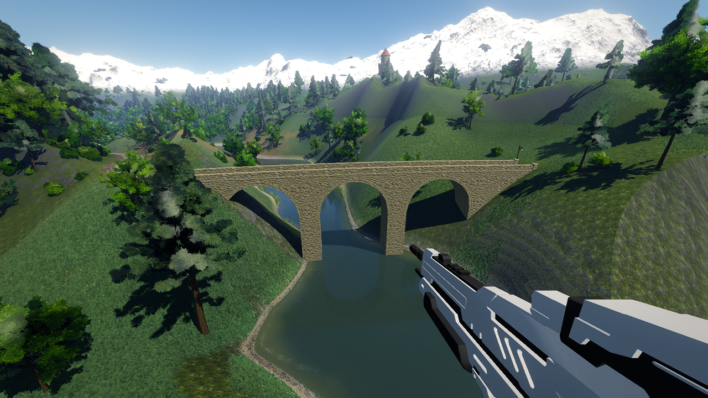
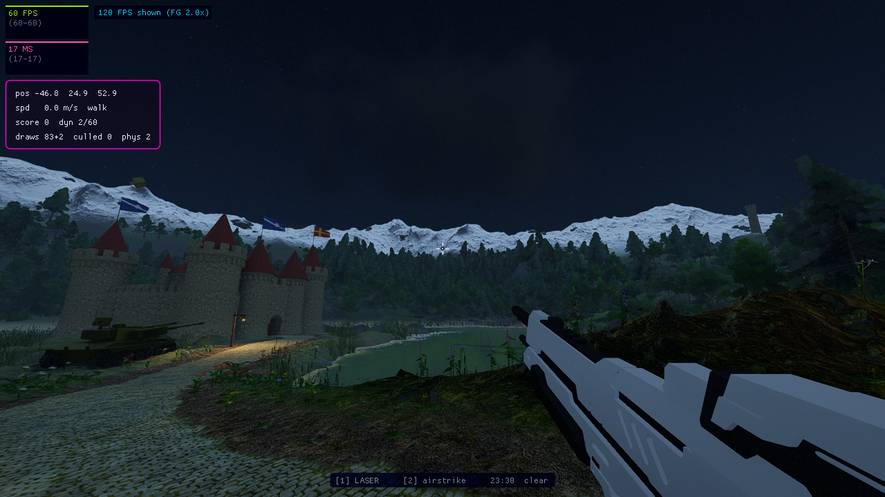
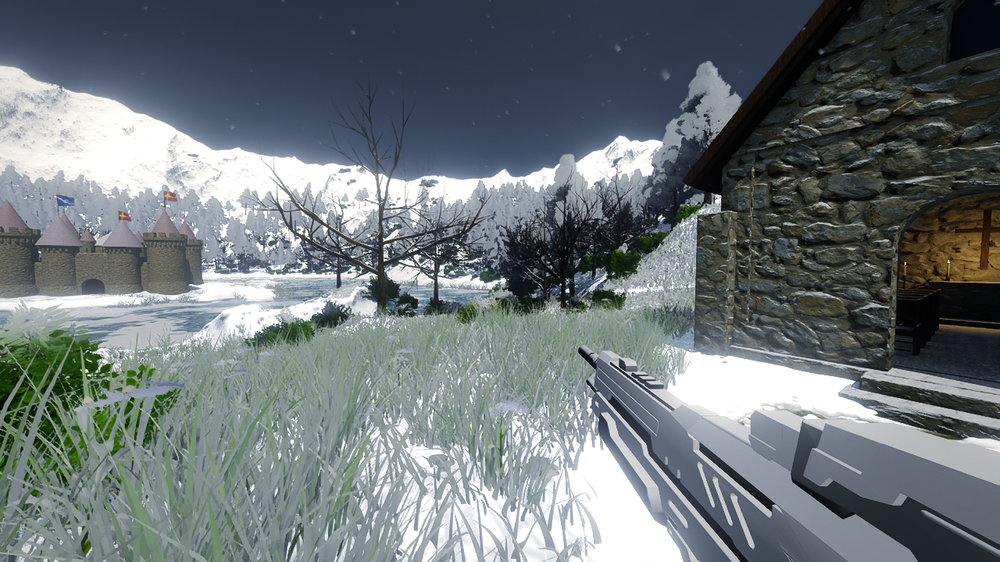
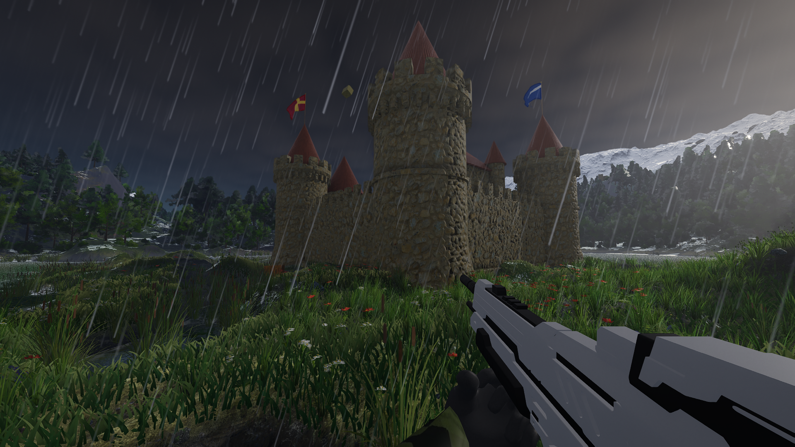
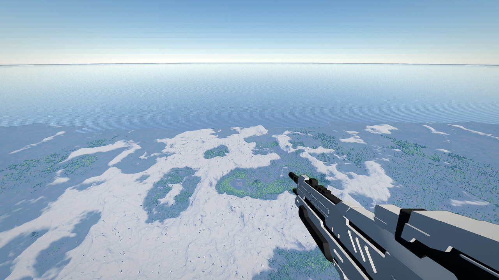

# Vibe - an open-world Vulkan game engine with ray tracing, written by AI

Vibe is a 3D game engine and first-person game in C++20 and Vulkan 1.3, written
entirely by AI (vibe coding with Claude Code): hardware ray tracing, a ray-marched procedural
planet, motion-matched characters and LAN multiplayer, with no Unreal, Unity or Godot underneath.


An open world on a full-size planet where you can walk, swim and fly from a castle courtyard
up to orbit, launch a rocket, and play together over LAN multiplayer, with day and night, four
seasons and live weather.

| | |
|---|---|
|  |  |
|  |  |
|  |  |
|  |  |
|  |  |

## The technology

A native C++20 application on Vulkan 1.3, with no game engine underneath: about 57,000 lines of
C++ and 22,000 lines of GLSL in 69 shader files. Windowing, math, physics, audio and networking
come from small libraries; the renderer, the world and the tools are written here.

The lists below name each technique and, where it follows published work, its source. Most are
switches in the settings menu, so they can be compared live.

### Ray tracing

Hardware ray tracing is required. Rays are traced inline from fragment and compute shaders
(ray queries, no separate ray-tracing pipeline).

| Technique | What it does |
|---|---|
| Acceleration structures | One bottom-level structure per mesh, static geometry merged, one top-level structure refit as things move; instance masks select what a ray may hit |
| Soft shadows | Sun shadows with a blocker search and a variable cone (PCSS-style), so they sharpen at the contact and soften with distance |
| Global illumination | Multi-bounce diffuse light from traced paths |
| Radiance cache | World-space spatial hash of outgoing light (SHaRC-style); a ray that hits a cached cell gets several bounces for the price of one |
| ReSTIR GI | Reservoir resampling of GI samples over time (optional) |
| Ambient occlusion | Screen-space GTAO by default, ray-traced AO as the high-quality choice |
| Reflections | Traced reflections of the scene on water and glossy surfaces |
| Light shafts | The volumetric fog traces a ray to the sun per froxel, so shafts fall through trees and windows |
| Denoising | SVGF (temporal variance + à-trous filter), or DLSS Ray Reconstruction at about one sample per pixel |

### Raymarched shaders

Much of the picture has no triangles behind it: it is computed per pixel by marching a ray
through a formula.

| Technique | What it does |
|---|---|
| Terrain | A fractal height formula marched in the fragment shader; the number of noise octaves falls with distance; pebbles, puddles, snow, footprints and ice are shading detail |
| Water | Sea, lake and river surface with waves, flow, foam, a visible bed and an underwater view |
| Grass | A field of individual blades as a signed distance field, standing on the real terrain |
| Volumetric clouds | Marched in a compute shader, grown from a 2D weather map |
| Atmosphere | Physically based sky from look-up tables (Hillaire 2020): transmittance, multiple scattering, sky view and an aerial-perspective volume |
| Volumetric fog | 160 x 90 x 64 camera-aligned froxels (Wronski 2014, Frostbite 2015), with mist that lies on the lake |
| Wall relief | Stonework marched into flat wall faces (parallax occlusion with silhouettes) |
| Explosions | Fireballs and smoke columns as marched noise volumes with a blackbody colour ramp |
| Voxels | A destructible tower traversed per pixel with a brick DDA |

### A planet-sized map

The world is a real sphere with a radius of 6360 km. Fly on round it and you come back home.

| Technique | What it does |
|---|---|
| One world formula | Continents, coasts, mountain ranges, the river and the ground under your feet come from one function, shared by the shaders and the CPU, so you can land, walk and swim anywhere |
| Hand-overs by altitude | Full-detail march near the ground; the march range grows to 80 km with height; then a shaded far field of the sphere takes over; above the atmosphere the sky gives way to space |
| One weather map | The same field grows the volumetric clouds below and paints the cloud systems seen from orbit: what you see from space is what you find on the way down |
| Charts of the sphere | The engine works in local flat coordinates that are re-anchored under the player every 16 km, so positions stay exact to the centimetre |
| Double precision where it matters | Camera matrices, terrain rays and the noise lattice are computed in doubles or relative to the camera; 32-bit floats cannot hold a position on a planet |
| Streamed vegetation | Beyond the home area the world is cut into 128 m cells whose trees are a pure function of their coordinates, generated on background threads, nearest first |

### Geometry at scale

| Technique | What it does |
|---|---|
| GPU-driven culling | Every tree, bush, rock and plant is culled in a compute shader (frustum + Hi-Z depth pyramid) and drawn with indirect draws |
| Levels of detail | Four mesh levels and an impostor per tree, picked on the GPU, with dithered cross-fades |
| Cluster LOD (Nanite-style) | Rocks and static meshes are cut into clusters of up to 128 triangles in a hierarchy (meshoptimizer); per cluster the level with under one pixel of error is drawn |
| Geometry streaming | The finest cluster level is read from disk on a background thread when the camera comes near |
| Procedural trees and plants | Trees are grown at load time, plants and their simplified levels are generated in code |
| Mesh terrain | A second terrain renderer with continuous distance-dependent LOD (CDLOD), next to the raymarched one |

### Image

| Technique | What it does |
|---|---|
| Deferred lighting | The scene is drawn into a G-buffer after a depth pre-pass and lit in one pass |
| Upscaling | NVIDIA DLSS (Streamline) or AMD FSR 3.1, with the engine's own TAA and temporal upsampler as fallback |
| Frame generation | DLSS Frame Generation (up to 4x) or FSR 3; AMD Anti-Lag 2 |
| HDR | HDR10 output where the display offers it; ACES, AgX or Khronos PBR Neutral tone mapping |
| Auto-exposure | Eye adaptation from the scene's average luminance |
| Bloom and lens flare | 13-tap downsample and tent upsample chain (Call of Duty: Advanced Warfare), ghosts and halo |
| Decals | Deferred decals that wrap laser burns over any surface |
| Colour grading | Temperature, vibrance, split toning, film grain and vignette |

### Simulation and tools

| Technique | What it does |
|---|---|
| Physics | Rigid bodies with Jolt |
| LAN multiplayer | Instances find each other, elect a host and share players, shots, weather, season and clock (ENet); other players are interpolated 100 ms in the past |
| Orbital mechanics | The rocket flies a real mission in double precision: gravity turn, 180 km circular orbit, one revolution, a retrograde burn and a powered landing on its mount |
| Day, seasons and weather | A sun, moon with phases and stars; four seasons and eleven kinds of weather that change the land and the light |
| Job system | Background threads for world generation and streaming |
| Self-inspection | The command line renders a chosen frame to a file and the log gives GPU time per pass, which is how the AI looks at and measures its own work |

## Requirements

Windows and a fast, recent graphics card with hardware ray tracing. Tested on a GeForce RTX 4080
(DLSS) and a Radeon RX 9070 XT (FSR). There is no low-end fallback.

## Download

A ready-to-run Windows build is on the [releases page](https://github.com/holoduke/vibe/releases):
unzip it and start `Vibe.cmd`. The first start prepares shaders for your graphics card in the
background; the terrain looks plain for about a minute.

## Build and run

Visual Studio 2022 and the Vulkan SDK 1.3. Other dependencies are fetched by CMake.

```powershell
./build.ps1 -Config Release
./build/vibe.exe        # run from the repository root
```

## Controls

| Key | Action |
|---|---|
| W A S D, mouse | Move, look |
| Space / Shift / Ctrl | Jump / sprint / crawl. In water: rise / swim fast / dive |
| Left mouse | Fire, or mark the airstrike target |
| 1 / 2 | Laser rifle / airstrike tablet |
| V | Fly |
| H | Back to the start |
| E | World editor; at the launch button: start the count |
| C | During a launch: ride along with the rocket (mouse turns the camera) |
| F | Flashlight |
| F12 | Save a screenshot |
| Esc | Menu with all settings |

## Code

- `src/engine/` — the Vulkan engine
- `src/game/` — player, collision, level
- `shaders/` — GLSL 4.60
- `docs/ARCHITECTURE.md` — the code map, with the details behind every technique above

## Credits

- Volumetric clouds: ported from
  [leoawen/volumetric_cloud_atmosphere_scattering](https://github.com/leoawen/volumetric_cloud_atmosphere_scattering) (MIT).
- Procedural trees: a C++ port of [dgreenheck/ez-tree](https://github.com/dgreenheck/ez-tree) (MIT).
- Sea waves: after "Seascape" by Alexander Alekseev (TDM), [shadertoy.com/view/Ms2SD1](https://www.shadertoy.com/view/Ms2SD1) (CC BY-NC-SA 3.0).
- Screen-space displacement (in the code, not currently used): after
  [TechArtAlex](https://www.patreon.com/TechArtAlex/posts/screen-space-171617266).
- Player character: [MakeHuman / MPFB](https://static.makehumancommunity.org/) community assets;
  tactical vest by MindFront (CC-BY).
- Character movement: motion capture from the 100STYLE dataset by Ian Mason, Sebastian Starke and Taku Komura
  (CC BY 4.0, https://www.ianxmason.com/100style/), retargeted to the soldier (`tools/anim/build_motion_db.py`).
- Libraries: GLFW, glm, Dear ImGui, VMA, vk-bootstrap, Jolt Physics, meshoptimizer, miniaudio,
  NVIDIA Streamline, AMD FidelityFX.

## Licence

The code and shaders written for this project are under the [MIT licence](LICENSE). Third-party
material (motion capture, the sea wave function, character assets, textures, vendor libraries)
keeps the licence of its source; see the list above and the notes in `LICENSE`.
