# Vibe — a 100 % AI-written (vibe coded) Vulkan ray-tracing game and engine

**Vibe is a real-time C++ / Vulkan 1.3 first-person game and engine with hardware ray tracing, a
raymarched open world, a castle, dynamic weather and a day/night cycle — written entirely by AI
through conversation ("vibe coding"). No human has read or written the code.**

*Formerly "Vulcan3D Vibecoded".*

    

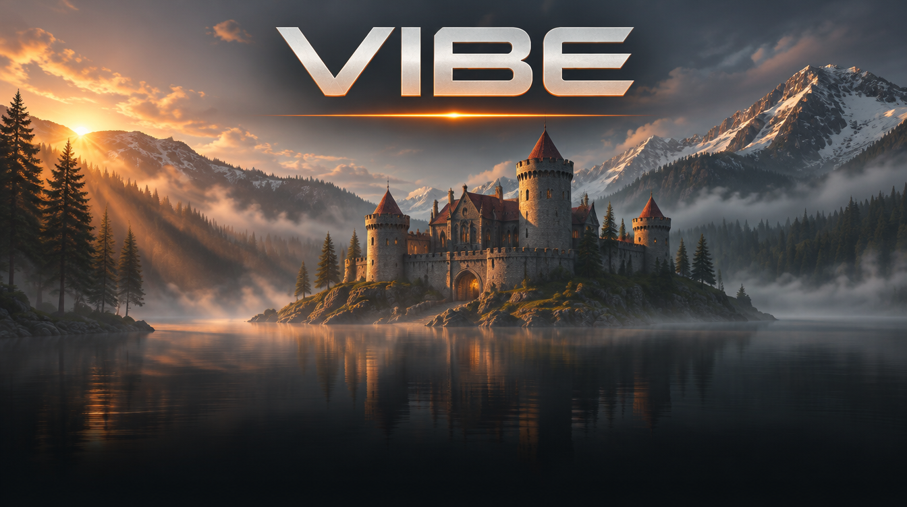

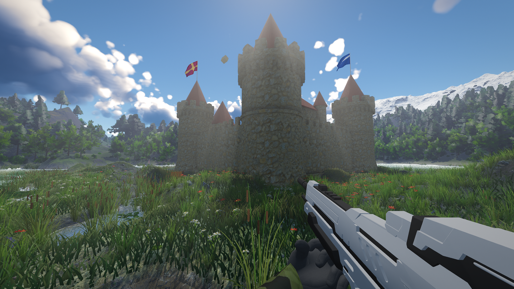

**Runs on NVIDIA and AMD.** Developed and tested on a GeForce RTX 4080 (DLSS 3) and a Radeon RX 9070 XT
(FSR 3.1). It is built for fast, recent graphics cards only: everything is ray traced and ray marched,
and there is no low-end fallback.

## What is this?

This repository is an experiment in **vibe coding**: building software by describing what you want
and looking only at the result. The rule of the project is simple:

> **The human never looks at the code.** They play the game, look at the picture, and say what is
> wrong or what should come next ("the shadow edges are spiky", "add rain", "make it faster in
> fullscreen"). An AI coding agent ([Claude Code](https://claude.com/claude-code)) does everything
> else: architecture, C++, GLSL shaders, debugging, profiling, regression testing and commits.

The goal is to find out how far that goes when the bar is deliberately high:

- **High-quality, modern graphics** — ray-traced shadows, global illumination and reflections,
  a physical sky, volumetric clouds and fog, the latest upscalers and frame generation.
- **High performance** — every feature is profiled on the GPU and has to earn its milliseconds.
- **Real engineering, not a tech demo** — settings that persist, test hooks, regression
  screenshots, validation-layer runs, crash diagnostics.

If you are curious whether an AI can build a non-trivial 3D engine without a human reading the
source: this is one data point, with the full commit history as the log.

## Screenshots

| Autumn: every tree turns at its own pace | Winter: the lake freezes (layered ice with cracks) |
|---|---|
|  | 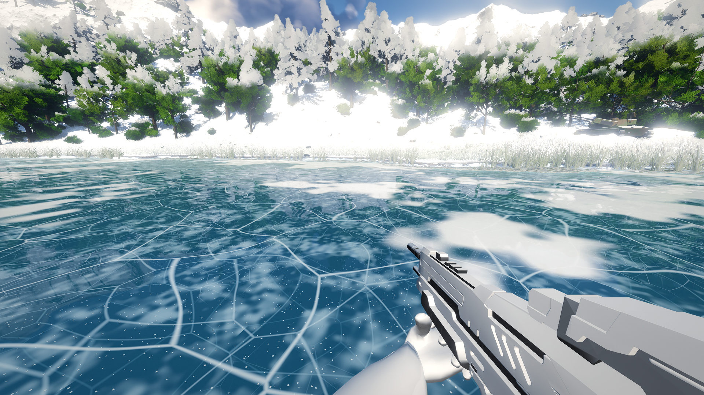 |

| Snow with real depth, and footprints pressed into it | Thunderstorm |
|---|---|
| 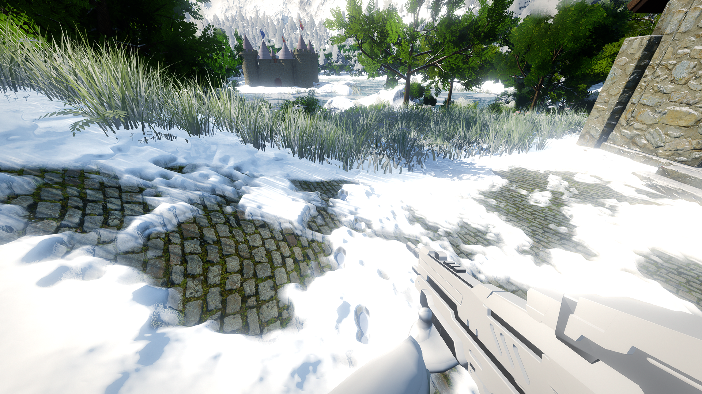 |  |

| Spring at the chapel | The in-game HUD |
|---|---|
|  | 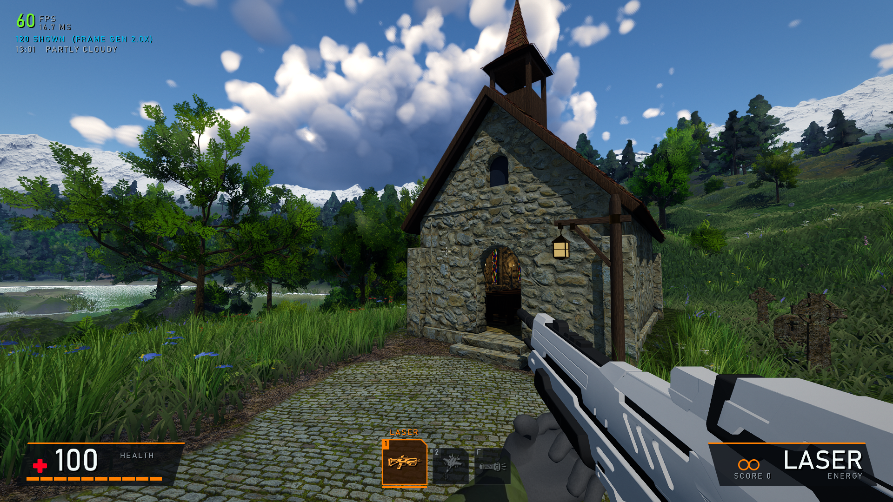 |

| Sunrise with volumetric light | Night: moonlight, stars, lanterns |
|---|---|
| 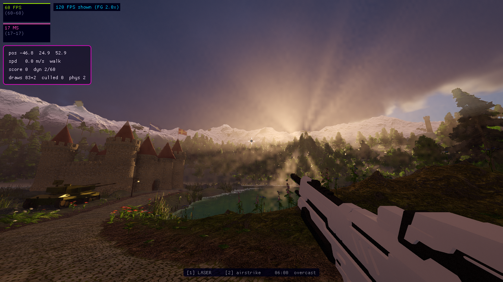 |  |

| Rain | Under water |
|---|---|
| 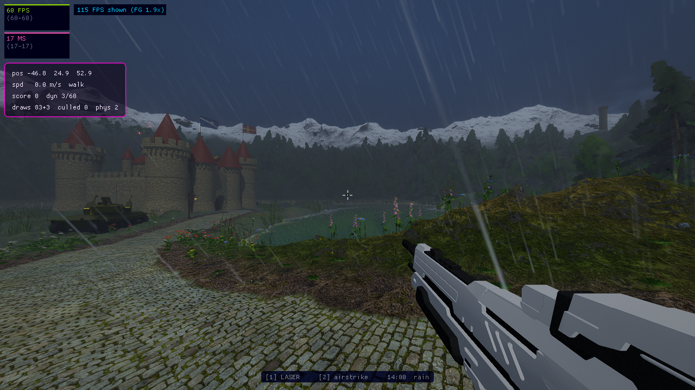 | 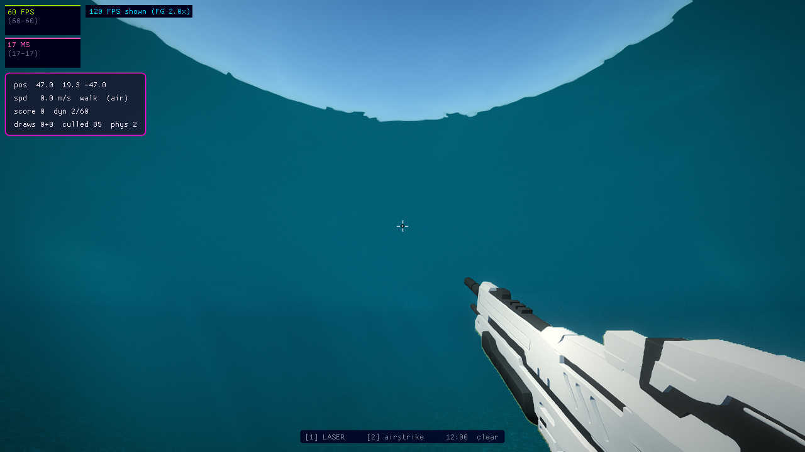 |

| The road to the castle | Lake shore with reeds and water lilies |
|---|---|
| 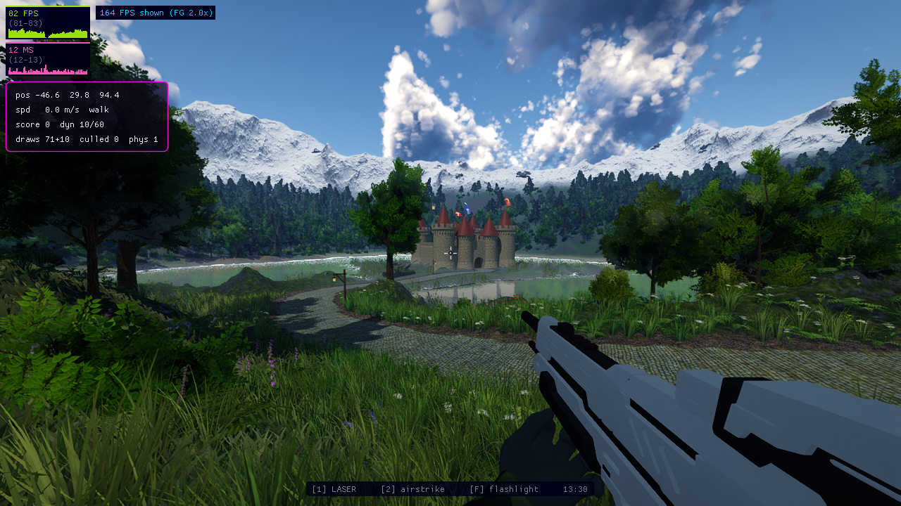 | 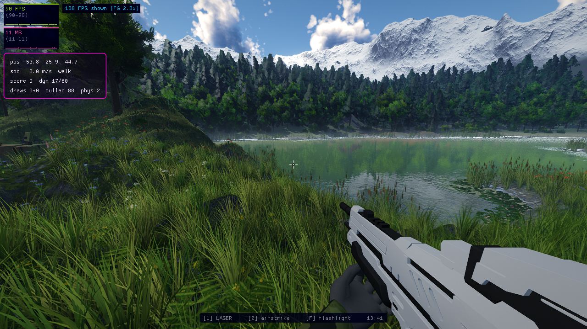 |

| Castle and lake from above | Courtyard at night, lit by lanterns |
|---|---|
| 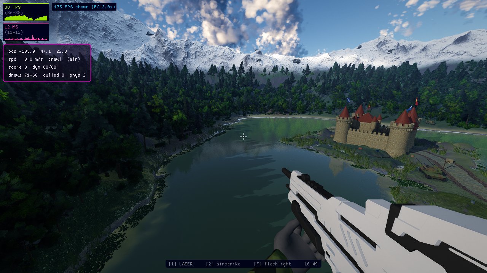 | 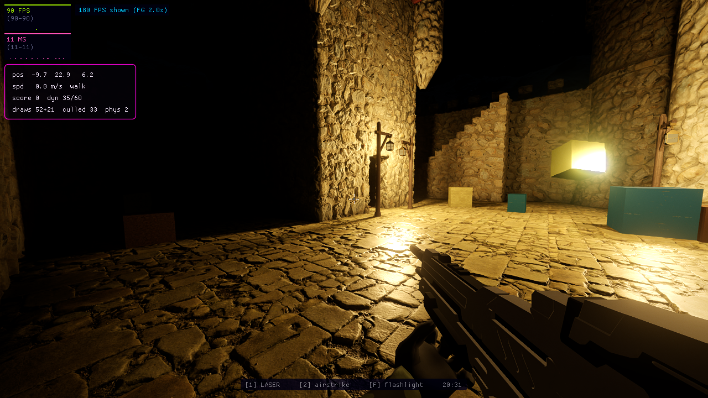 |

| The lake from the air |
|---|
| 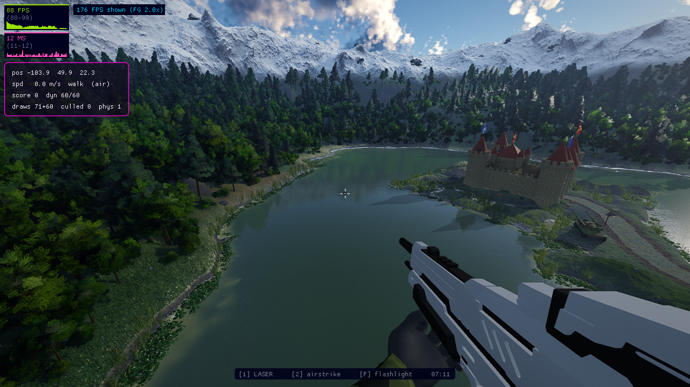 |

| Water splash and ripples |
|---|
| 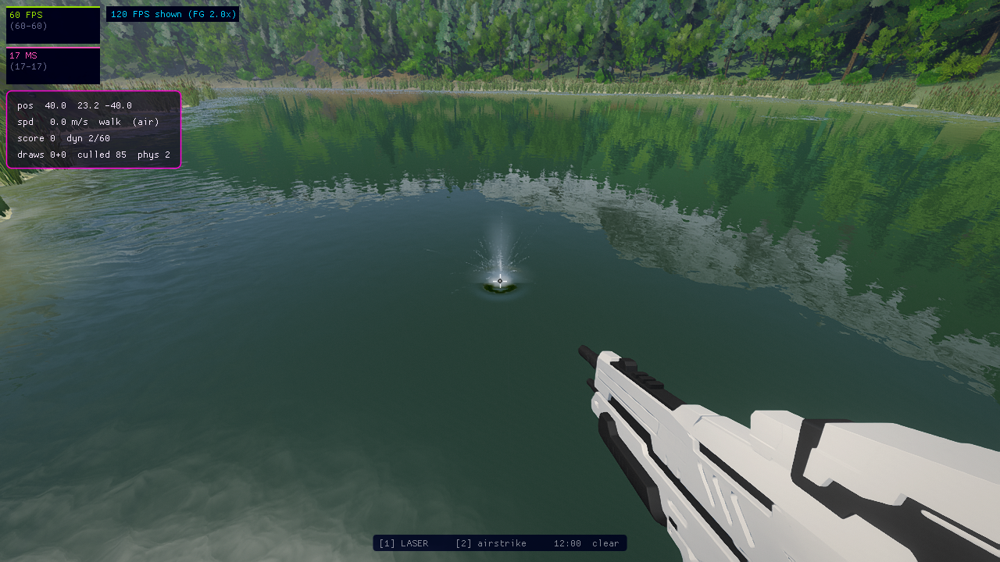 |

## Features

### Rendering
- **Vulkan 1.3 deferred renderer** with inline hardware ray tracing (`VK_KHR_ray_query`):
  ray-traced soft sun shadows, ambient occlusion, global illumination and reflections against a
  TLAS / BLAS scene, with alpha-tested foliage in the ray queries.
- **Upscaling and frame generation**: NVIDIA DLSS Super Resolution, DLSS Ray Reconstruction and
  DLSS Frame Generation (Streamline, with Reflex), AMD FSR 3.1 upscaling and FSR 3 frame
  generation, AMD Anti-Lag 2. The GPU vendor is detected and the best path is picked automatically.
- **Raymarched procedural terrain** (FBM heightfield with a baked height map for fast skipping),
  with roads, bomb craters that turn to mud, and close-range ground relief.
- **Raymarched SDF grass** plus GPU-driven vegetation: compute-shader culling, hi-Z occlusion,
  LOD buckets, procedural trees, 16 species of ground plants (every plant culled and given a
  level of detail on the GPU).
- **Cluster level of detail** (Nanite-style, built with
  [meshoptimizer](https://github.com/zeux/meshoptimizer)): rocks, the castle and the chapel are
  cut into clusters with a seamless hierarchy; detail is picked and hidden per cluster on the
  GPU, the sun shadows draw from the same data and the finest level is streamed in from disk.
- **Displaced stone walls**: relief-marched castle masonry with real stone-by-stone silhouettes,
  worn corners, self-shadowing and contact shadows where walls meet the ground.
- **Procedural pebbles**: formula-generated stones, gravel and grit that stay sharp at any
  distance, a packed pebble lake bed and lace-like shore foam.
- **Physical sky** (Hillaire atmosphere LUTs), **volumetric clouds**, **froxel volumetric fog**
  with ray-traced light shafts, aerial perspective, auto exposure, bloom, lens flare,
  ACES / AgX / PBR-Neutral tonemapping and HDR10 output.

### World simulation
- **Day / night cycle**: the sun follows a real diurnal arc; golden hour, blue hour, moonlight,
  stars and road lanterns that light up at dusk. The clock speed is a setting.
- **Seasons**: spring, summer, autumn (the leaves turn, tree by tree) and winter (snow lies as a
  ray-marched layer with drifts, the lake freezes into layered ice you can walk on, feet leave
  prints with real depth).
- **Dynamic weather**: eleven types from clear to fog, rain, snow, dry thunder and night
  thunderstorms. Weather drives cloud cover, fog, light colour, wind, rain or snow, rings on the
  water, wet ground, rain pools, sound, lightning and thunder. Every change of weather or season
  cross-fades over a configurable time (1 second to 5 minutes).
- **LAN multiplayer**: games on the same network find each other and join by themselves (one
  becomes the host); other players are interpolated the way Half-Life and Source do it, and the
  weather, season and clock are shared.
- **Water**: reflective lake with splashes and expanding ripples when shot, swimming and diving,
  and an underwater view with light absorption, caustics, light shafts and Snell's window.
- **In-game world editor**: press E, pick trees, bushes or grass from a bar and paint them
  onto the landscape.
- **Combat sandbox**: laser rifle, an airstrike tablet that calls in a bomber, anti-aircraft
  vehicles, jets that can be shot down, volumetric explosions, an optional destructible voxel tower,
  cloth flags, [Jolt Physics](https://github.com/jrouwe/JoltPhysics) rigid bodies.

## Build and run

Windows, Visual Studio 2022, Vulkan SDK 1.3 and a **fast, recent graphics card with hardware ray
tracing**. NVIDIA and AMD are both supported and tested (GeForce RTX 4080, Radeon RX 9070 XT); the
upscaler and frame generation are picked automatically (DLSS on NVIDIA, FSR 3.1 on AMD). Older or
mid-range cards will start but will not reach a playable frame rate.

```powershell
./build.ps1 -Config Release
./build/vibe.exe        # run from the repository root
```

Dependencies (GLFW, glm, Dear ImGui, VMA, vk-bootstrap, Jolt Physics, tinygltf, miniaudio, …)
are fetched by CMake. FidelityFX and the NVIDIA Streamline SDK are vendored under `external/`.

## Controls

| Key | Action |
|---|---|
| W A S D, mouse | Move, look |
| Space / Shift / Ctrl | Jump (double jump) / sprint / crawl. In water: rise / swim fast / dive |
| Left mouse | Fire, or mark the airstrike target |
| 1 / 2 | Laser rifle / airstrike tablet |
| V | Free-fly camera |
| E | World editor: 1-5 pick what to plant, left mouse paints, right mouse removes |
| F | Flashlight (left mouse: brightness) |
| F12 | Photo: saves a clean PNG (no HUD) to `screenshots/` |
| Esc | Pause menu with every graphics, weather and gameplay setting |

Settings are saved to `vibe_settings.cfg`. Time of day, clock speed and weather live in the
pause menu under **Graphics Settings → Time of day & weather**.

## FAQ

**Can an AI write a complete 3D game engine?** This repository is the experiment. Every line of
C++ and GLSL here was written by an AI agent; the human only plays the build and says what to
change. The commit history is the full record.

**What is vibe coding?** Building software by describing what you want in plain language and
judging only the result, without reading the code.

**Which AI wrote it?** [Claude Code](https://claude.com/claude-code), Anthropic's coding agent.

**What hardware does it need?** Windows and a fast, recent graphics card with hardware ray
tracing. It runs on both NVIDIA and AMD (tested on a GeForce RTX 4080 and a Radeon RX 9070 XT).
It is not meant for slow or older cards.

**Is it a game or an engine?** Both: a small open-world shooter sandbox (castle, lake, forest,
jets, airstrikes) on top of a custom Vulkan engine.

## How it is developed

1. The human plays the build and describes a wish or a defect in plain language.
2. The AI agent reads the code base, researches the technique, implements it, builds, launches
   the game with test hooks, takes screenshots and GPU timings, and compares them to a baseline.
3. The agent commits and pushes; the human looks at the result — never at the diff.

Everything in this repository — engine, shaders, tools, synthesised sound effects, this README —
was produced that way.

## Project layout

- `src/engine/` — Vulkan engine: passes, ray tracing, terrain, vegetation, weather, water, audio, UI.
- `src/game/` — player movement, collision, level.
- `shaders/` — GLSL 4.60, compiled to SPIR-V at build time.
- `assets/` — models, textures, sounds.
- `docs/` — the code map (`docs/ARCHITECTURE.md`), design notes and screenshots.

## Credits

Parts of this project are ports of other people's open-source work (MIT licensed):

- **Volumetric clouds**: the cloud model (shape / detail / weather noise, vertical shaping,
  marching and lighting terms) is ported from
  [leoawen/volumetric_cloud_atmosphere_scattering](https://github.com/leoawen/volumetric_cloud_atmosphere_scattering)
  (Copyright (c) 2025 leoawen), rescaled from a planet to a landscape.
- **Procedural trees**: the growth algorithm is a C++ port of
  [dgreenheck/ez-tree](https://github.com/dgreenheck/ez-tree) (Copyright (c) 2024 Daniel Greenheck).

The player character is built with [MakeHuman / MPFB](https://static.makehumancommunity.org/)
from its community assets (script: `tools/character/make_soldier.py`):

- Body, skin, field uniform: MakeHuman system assets (CC0).
- **Tactical vest**: "Tactical vest (male)" by MindFront, CC-BY (widened to fit over the jacket).
- Boots by culturalibre, gloves by MargaretToigo, M1 helmet by MrGreaterThan (all CC0; boots and
  gloves recoloured).

## Keywords

Vulkan game engine, C++ Vulkan renderer, real-time ray tracing, ray query, deferred rendering,
DLSS 3 frame generation, DLSS ray reconstruction, FSR 3, raymarched terrain, SDF grass,
volumetric clouds, volumetric fog, physical sky, day night cycle, dynamic weather system, rain,
seasons, snow, ice shader, footprints in snow, LAN multiplayer, Nanite-style cluster LOD, meshoptimizer,
NVIDIA and AMD,
water rendering, underwater shader, GPU-driven rendering, vibe coding, AI-generated code,
AI-written game engine, AI-made game, vibe coded game, Claude Code, LLM coding experiment,
parallax occlusion mapping, relief mapping, procedural pebbles, open-world castle, in-game editor.
