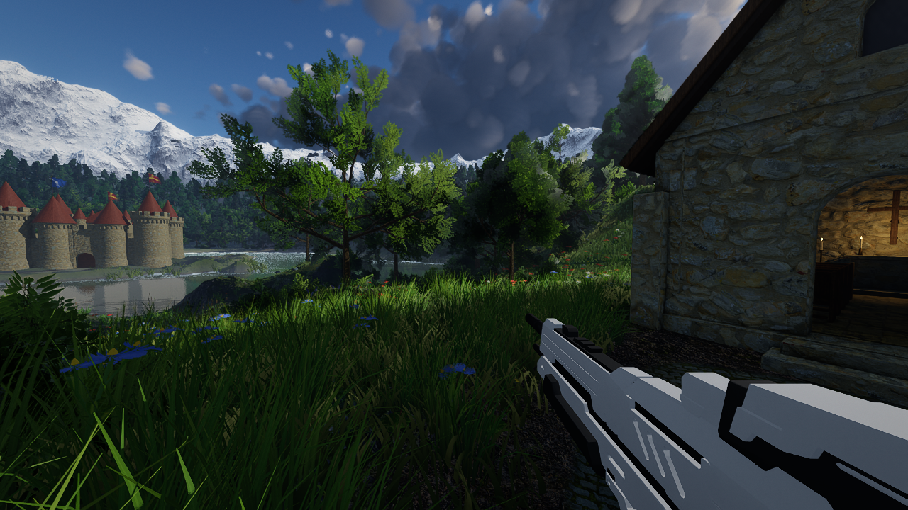
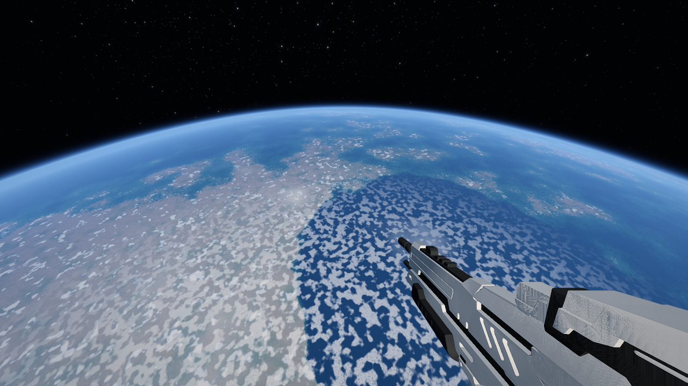

# Vibe

A ray-traced open-world engine and its first-person game, written in C++ and Vulkan 1.3, entirely by AI.

**The idea:** the human never reads or writes the code. They play the build, look at the
picture and say what is wrong or what should come next. An AI coding agent
([Claude Code](https://claude.com/claude-code)) does the rest: design, C++, shaders, debugging,
profiling, testing and commits. This repository is the result, and its commit history is the log.


## What it is

A small open world on a full-size planet: a castle by a lake, forests, a river and a sea coast,
with day and night, four seasons and live weather. You can walk, swim and fly through it, from
the castle courtyard up to orbit, without a loading screen. The game is a sandbox; the engine
underneath is the point of this repository.

| | |
|---|---|
|  |  |
|  |  |
|  |  |
|  |  |
|  |  |

## The technology

A native C++20 application on Vulkan 1.3, with no game engine underneath: about 57,000 lines of
C++ and 22,000 lines of GLSL in 69 shader files. Windowing, math, physics, audio and networking
come from small libraries (see Credits); the renderer, the world and the tools are written here.

### Ray tracing

Hardware ray tracing is required, not optional. Rays are traced inline from the fragment and
compute shaders with ray queries, against a scene of bottom-level structures per mesh and one
top-level structure rebuilt as things move.

- **Shadows**: ray-traced shadows, also inside the volumetric fog.
- **Global illumination**: bounce light from traced rays, backed by a world-space radiance
  cache (a spatial hash in the style of SHaRC), so one ray carries several bounces. ReSTIR GI
  and an SVGF denoiser are in the code as options.
- **Reflections**: traced reflections on the water.
- Lighting is deferred: the scene is drawn into a G-buffer and lit in one pass.

### Raymarched shaders

Much of the picture has no triangles behind it. It is computed per pixel by marching a ray
through a formula:

- **Terrain**: the ground is a height formula marched in the fragment shader, with pebbles,
  puddles, snow, footprints and ice as shading detail.
- **Water**: sea, lake and river surface, with waves, foam and a visible bed.
- **Grass**: individual blades, raymarched, standing on the terrain.
- **Clouds and sky**: volumetric clouds in a compute shader, a physically based atmosphere
  with aerial perspective, and froxel fog with mist over the lake.
- **Stone walls**: the relief of the castle's masonry is marched into flat wall faces.

### A planet-sized map

The world is a real sphere with a radius of 6360 km. Fly on round it and you come back home.

- **One formula at every zoom level**: continents, coasts, mountain ranges, the river and the
  ground under your feet all come from the same function, shared by the shaders and the CPU
  (so you can land, walk and swim anywhere). What you see from orbit is what you find on the
  way down.
- **Hand-overs by altitude**: near the ground the terrain is marched in full detail; with
  height the march range grows to 80 km, then a shaded far field of the sphere takes over, and
  above the atmosphere the sky gives way to space. The same weather map drives the volumetric
  clouds below and the cloud systems seen from orbit.
- **Number precision**: 32-bit floats cannot hold a position on a planet. The engine works in
  local charts of the sphere that are re-anchored under the player every 16 km, computes the
  camera matrices in double precision, and hands the noise functions their lattice position
  in doubles.
- **Streaming**: beyond the home area the world is cut into 128 m cells whose trees and
  bushes are a pure function of their coordinates, generated on background threads, nearest
  first.

### Geometry at scale

- **GPU-driven vegetation**: every tree, bush and rock instance is frustum- and
  occlusion-culled (depth pyramid) in a compute shader, given one of four mesh levels or an
  impostor, and drawn with indirect draws.
- **Cluster LOD in the style of Nanite**: rocks and the castle's static meshes are cut into
  clusters of up to 128 triangles in a hierarchy (meshoptimizer); a compute shader picks, per
  cluster, the level whose error is under one pixel. The finest level is streamed from disk
  when the camera comes near.
- **Procedural content**: trees are grown at load time, plants and their lower levels of
  detail are generated in code.

### Image and performance

- Upscaling and frame generation with NVIDIA DLSS 3 (Streamline) or AMD FSR 3.1, with a
  built-in TAA as fallback.
- HDR pipeline with automatic exposure, bloom and tone mapping.
- A job system for background work, GPU timings per pass in the log, and a command line that
  renders a given frame to a file, which is how the AI looks at its own work.

### Simulation

- Rigid-body physics with Jolt.
- LAN multiplayer over ENet: instances find each other, elect a host, and share players,
  shots, weather, season and clock.
- A rocket that flies a real mission: gravity turn, a 180 km circular orbit, one revolution,
  a retrograde burn and a powered landing back on its mount, simulated in double precision.

## Requirements

Windows and a fast, recent graphics card with hardware ray tracing. Tested on a GeForce RTX 4080
(DLSS) and a Radeon RX 9070 XT (FSR). There is no low-end fallback.

## Build and run

Visual Studio 2022 and the Vulkan SDK 1.3. Other dependencies are fetched by CMake.

```powershell
./build.ps1 -Config Release
./build/vibe.exe        # run from the repository root
```

## Controls

| Key | Action |
|---|---|
| W A S D, mouse | Move, look |
| Space / Shift / Ctrl | Jump / sprint / crawl. In water: rise / swim fast / dive |
| Left mouse | Fire, or mark the airstrike target |
| 1 / 2 | Laser rifle / airstrike tablet |
| V | Fly |
| H | Back to the start |
| E | World editor; at the launch button: start the count |
| C | During a launch: ride along with the rocket (mouse turns the camera) |
| F | Flashlight |
| F12 | Save a screenshot |
| Esc | Menu with all settings |

## Code

- `src/engine/` — the Vulkan engine
- `src/game/` — player, collision, level
- `shaders/` — GLSL 4.60
- `docs/ARCHITECTURE.md` — the code map, with the details behind every technique above

## Credits

- Volumetric clouds: ported from
  [leoawen/volumetric_cloud_atmosphere_scattering](https://github.com/leoawen/volumetric_cloud_atmosphere_scattering) (MIT).
- Procedural trees: a C++ port of [dgreenheck/ez-tree](https://github.com/dgreenheck/ez-tree) (MIT).
- Sea waves: after "Seascape" by Alexander Alekseev (TDM), [shadertoy.com/view/Ms2SD1](https://www.shadertoy.com/view/Ms2SD1) (CC BY-NC-SA 3.0).
- Screen-space displacement (in the code, not currently used): after
  [TechArtAlex](https://www.patreon.com/TechArtAlex/posts/screen-space-171617266).
- Player character: [MakeHuman / MPFB](https://static.makehumancommunity.org/) community assets;
  tactical vest by MindFront (CC-BY).
- Libraries: GLFW, glm, Dear ImGui, VMA, vk-bootstrap, Jolt Physics, meshoptimizer, miniaudio,
  NVIDIA Streamline, AMD FidelityFX.
