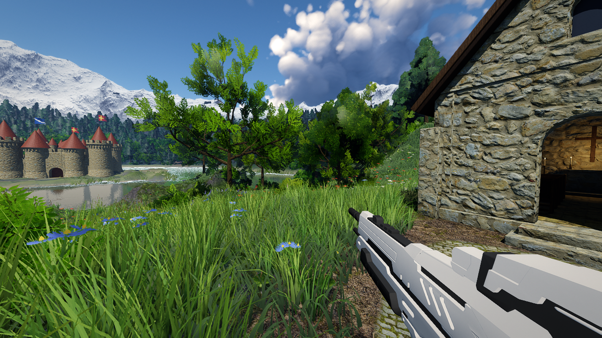
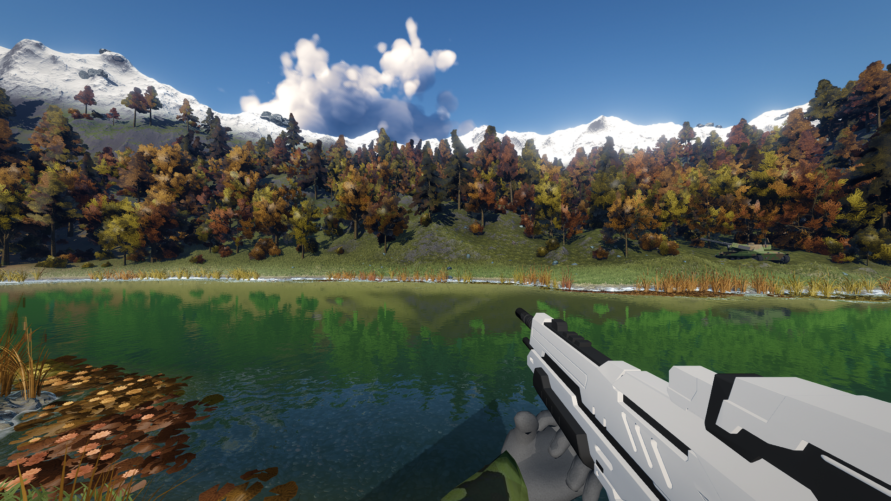
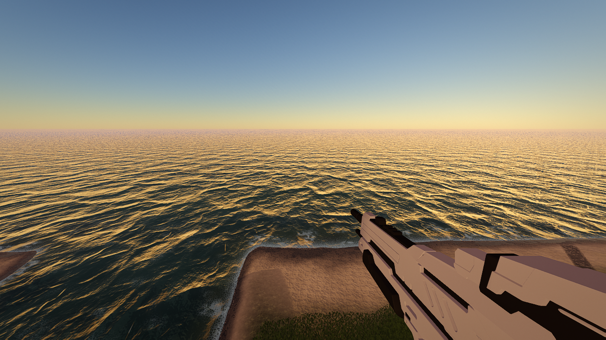
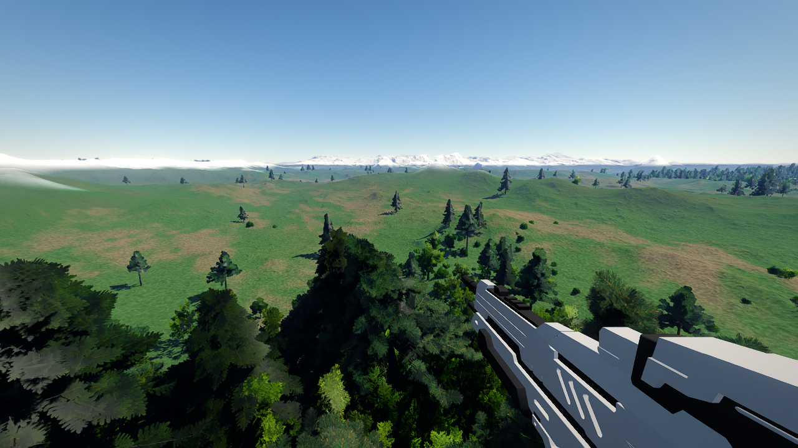

# Vibe

A first-person game and its engine, written in C++ and Vulkan 1.3, entirely by AI.

**The idea:** the human never reads or writes the code. They play the build, look at the
picture and say what is wrong or what should come next. An AI coding agent
([Claude Code](https://claude.com/claude-code)) does the rest: design, C++, shaders, debugging,
profiling, testing and commits. This repository is the result, and its commit history is the log.



## What it is

A small open world you can walk, swim and fly through, from a castle by a lake up to orbit.

- A castle, a chapel, a road, a river with a stone bridge, forests and a sea coast.
- One planet: the landscape continues beyond the home area with procedural terrain, trees and
  grass, and you can fly from the ground to space without a loading screen.
- Day and night, four seasons and eleven kinds of weather, all changing live.
- Ray-traced shadows, lighting and reflections; raymarched terrain, grass, clouds and fog.
- A sandbox to play in: a laser rifle, airstrikes, jets you can shoot down, physics objects.
- A launch site on the coast: press the button in the control house and a rocket flies to orbit,
  goes once round the planet and lands back on its mount (real orbital mechanics, sped up while
  it is out of sight).
- LAN multiplayer: games on the same network find each other and share weather, season and clock.
- An in-game editor to paint trees, bushes and grass.

| | |
|---|---|
|  |  |
|  |  |
|  |  |
|  |  |
|  |  |

## Requirements

Windows and a fast, recent graphics card with hardware ray tracing. Tested on a GeForce RTX 4080
(DLSS) and a Radeon RX 9070 XT (FSR). There is no low-end fallback.

## Build and run

Visual Studio 2022 and the Vulkan SDK 1.3. Other dependencies are fetched by CMake.

```powershell
./build.ps1 -Config Release
./build/vibe.exe        # run from the repository root
```

## Controls

| Key | Action |
|---|---|
| W A S D, mouse | Move, look |
| Space / Shift / Ctrl | Jump / sprint / crawl. In water: rise / swim fast / dive |
| Left mouse | Fire, or mark the airstrike target |
| 1 / 2 | Laser rifle / airstrike tablet |
| V | Fly |
| H | Back to the start |
| E | World editor; at the launch button: start the count |
| C | During a launch: ride along with the rocket (mouse turns the camera) |
| F | Flashlight |
| F12 | Save a screenshot |
| Esc | Menu with all settings |

## Code

- `src/engine/` — the Vulkan engine
- `src/game/` — player, collision, level
- `shaders/` — GLSL
- `docs/ARCHITECTURE.md` — the code map

## Credits

- Volumetric clouds: ported from
  [leoawen/volumetric_cloud_atmosphere_scattering](https://github.com/leoawen/volumetric_cloud_atmosphere_scattering) (MIT).
- Procedural trees: a C++ port of [dgreenheck/ez-tree](https://github.com/dgreenheck/ez-tree) (MIT).
- Sea waves: after "Seascape" by Alexander Alekseev (TDM), [shadertoy.com/view/Ms2SD1](https://www.shadertoy.com/view/Ms2SD1) (CC BY-NC-SA 3.0).
- Screen-space displacement (in the code, not currently used): after
  [TechArtAlex](https://www.patreon.com/TechArtAlex/posts/screen-space-171617266).
- Player character: [MakeHuman / MPFB](https://static.makehumancommunity.org/) community assets;
  tactical vest by MindFront (CC-BY).
- Libraries: GLFW, glm, Dear ImGui, VMA, vk-bootstrap, Jolt Physics, meshoptimizer, miniaudio,
  NVIDIA Streamline, AMD FidelityFX.
